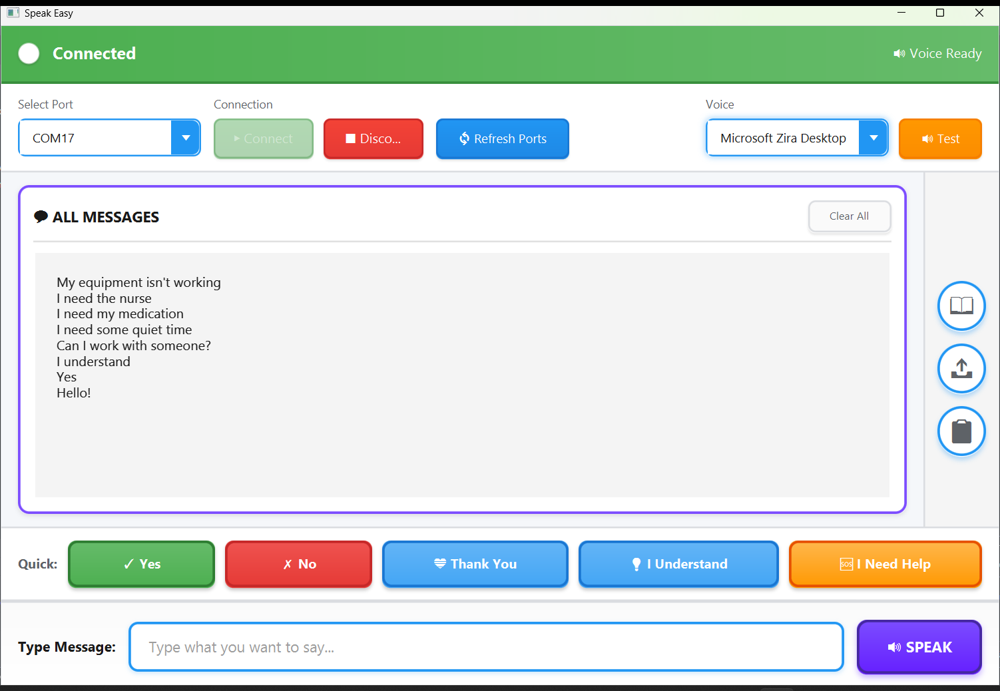
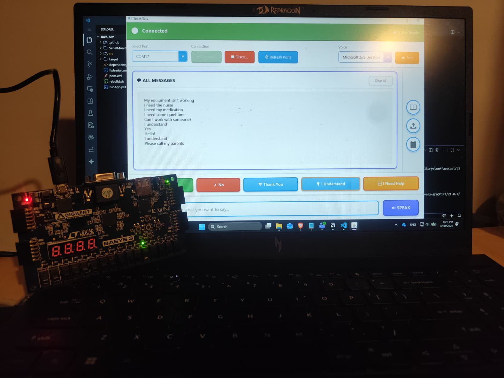
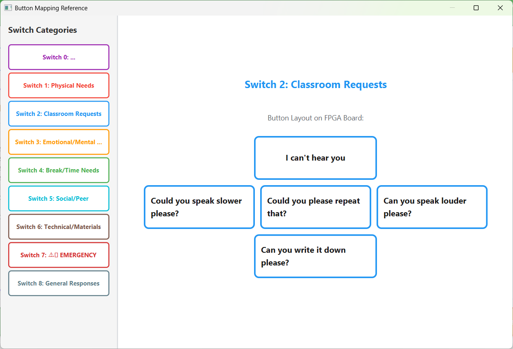

# SoulVoice 🎵

> **FPGA-based assistive communication system with text-to-speech**

This project is part of a suite of applications made for helping students or teenagers with health problems or neurodivergency.


---

<p align="center">
  
  <br>
  <em>SoulVoice desktop application with connected FPGA board</em>
</p>

---

## 📷 Live Demo
<div align="center">

https://github.com/user-attachments/assets/fecc90b9-0326-4105-aa8e-989bdb2f7d19

<em>Demonstration of category selection on the Basys3 FPGA board triggering live text-to-speech output</em>
</div>

---

## 📖 Table of Contents

- [System Overview](#system-overview)
- [Hardware Architecture](#hardware-architecture)
- [Software Architecture](#software-architecture)
- [Installation & Setup](#installation--setup)
- [Project Structure](#project-structure)
- [Authors & Coordination](#authors--coordination)
- [License](#license)

---

## 🔧 System Overview

SoulVoice is a hardware-software communication system consisting of:
- **FPGA Board:** Basys3 Artix-7 with 8 switches and 5 buttons for message selection
- **Desktop Application:** JavaFX-based interface with Microsoft TTS integration
- **Communication Protocol:** UART serial at 115200 baud

**Workflow:**
```
Switch Selection (8-bit) → Button Press (5 options) → UART TX → Serial RX → TTS Engine → Audio Output
```

**Capacity:**
- 45 preset messages (9 categories × 5 messages per category)
- Unlimited custom text-to-speech via keyboard input

---

## 🔌 Hardware Architecture

### Basys3 Artix-7 FPGA Board

**Input Interface:**
- **8 Slide Switches:** Category selection (Understanding, Physical Needs, Classroom Requests, Emotional State, Break/Time, Social, Technical, Emergency, General)
- **5 Push Buttons:** Message selection within category (Center, Up, Down, Left, Right)

**Communication:**
- **UART Transmitter:** 115200 baud, 8-N-1 configuration
- **USB-UART Bridge:** FT2232HQ chip for PC connectivity

---

<p align="center">
  
  <br>
  <em>Basys3 Artix-7 FPGA board with labeled switches and buttons</em>
</p>

---

### FPGA Implementation (Verilog)

**Core Modules:**
- Switch Decoder (8-bit input → 9 categories)
- Button Debouncer (5 buttons with 10ms debounce)
- State Machine FSM (Category + Button → Message ID)
- Message ROM/LUT (45 preset message strings)
- UART Transmitter (115200 baud, 8-N-1, no parity)

**Communication Protocol:**
```
The pre-stored messages and fetched at runtime based on the current active switch and pushed button.  
For example, selecting Category 2 (Classroom Requests) and Button 0 yields the exact byte sequence:  
“Could you please repeat that?\n”.
```

---

## 💻 Software Architecture

### Java Desktop Application (JavaFX 21)

**Architecture Layers:**
```
UI Layer (FXML/CSS)
    ↓
Controller Layer (MainController.java)
    ↓
Service Layer (SerialBackend.java, TtsService.java)
    ↓
Hardware/OS Integration (jSerialComm, Microsoft SAPI)
```

**Key Technologies:**

| Component | Technology | Purpose |
|-----------|-----------|---------|
| UI Framework | JavaFX 21 | Desktop interface |
| Serial Communication | jSerialComm 2.9.1 | Serial port access |
| Text-to-Speech | Microsoft SAPI | Windows TTS engine |
| Build System | Maven 3.8+ | Dependency management |

**UI Features:**
- High-contrast accessible design (WCAG 2.1 Level AA)
- Real-time message display with auto-scroll
- Interactive button mapping reference window
- Message history tracking
- Voice selection with live preview
- Automatic connection diagnostics

---

<p align="center">
  
  <br>
  <em>Interactive mapping guide showing all message categories and button layouts</em>
</p>

---

## 🚀 Installation & Setup

### Prerequisites

**Hardware:**
- Basys3 Artix-7 FPGA Board
- USB Type-A to Micro-B cable
- Windows PC (Windows 10/11)

**Software:**
- Java Runtime Environment 17+ (end users)
- Vivado 2023.x (FPGA programming only)
- Maven 3.8+ (development only)

### Quick Start

#### 1. Program the FPGA

```bash
# Clone repository
git clone https://github.com/TarnitaRobert/SoulVoice.git
cd SoulVoice/FPGA

# Open in Vivado → File → Project → Open → SoulVoice.xpr
# Generate bitstream → Program and Debug → Generate Bitstream
# Program device → Hardware Manager → Open Target → Program Device
```

#### 2. Run Desktop Application

**Option A: Run from Source (Development)**
```bash
cd Java_App

# Run with Maven (clears cache automatically)
.\runApp.ps1
```

**Option B: Build from Source and run .exe**
```bash
cd Java_App

# Windows (PowerShell)
.\rebuild.ps1

# Linux/macOS/Git Bash
./rebuild.sh

# Output: SerialMonitor/SoulVoice.exe
```

#### 3. Connect & Test

1. Connect Basys3 board via USB
2. Launch SoulVoice.exe
3. Select COM port from dropdown
4. Click "▶ Connect"
5. Test: Flip switch 8 → Press center button → Should speak "Yes"

---

## 🔧 Technical Implementation

### FPGA Design Specifications

**Resource Utilization (Artix-7 35T):**
- Slice LUTs: ~150 (< 1%)
- Slice Registers: ~200 (< 1%)
- Block RAM: 1 BRAM

**Timing:**
- System Clock: 100 MHz
- UART bit period: 86.8 μs (115200 baud)
- Debounce period: 10ms

### Java Application Specifications

**Serial Port Configuration:**
- Baud Rate: 115200
- Data Bits: 8, Stop Bits: 1, Parity: None

**TTS Configuration:**
- Engine: Microsoft SAPI 5.4
- Voice: User-selectable

---

## 📁 Project Structure

```
SoulVoice/
├── FPGA/                          # Hardware Design
│   ├── SoulVoice.hw/
│   ├── SoulVoice.srcs/
│   │   ├── sources_1/             # Verilog modules
│   │   └── constrs_1/             # Pin constraints
│   └── SoulVoice.xpr              # Vivado project
│
├── Java_App/                      # Desktop Application
│   ├── SerialMonitor/
│   │   └── SoulVoice.exe          # ⭐ Executable
│   ├── src/main/
│   │   ├── java/com/transmitter/  # Source code
│   │   └── resources/             # FXML & CSS
│   ├── pom.xml
│   ├── runApp.ps1                 # Run from source
│   ├── clearJserialcommCache.ps1  # Cache cleaner
│   ├── rebuild.ps1                # PowerShell build
│   └── rebuild.sh                 # Bash build
│
├── images/                        # Documentation
├── README.md
└── LICENSE
```

---


## 👥 Authors & Coordination

### Authors

**Tarnita Robert Gabriel**  
📧 tarnita.robert@proton.me

### Project Coordinator

**Prof.Dr.Ing Cirlugea Mihaela Cristina**  
Department of Bases of Electronics, Technical University of Cluj-Napoca, Romania  
📧 Mihaela.Cirlugea@bel.utcluj.ro

### Acknowledgments
- AI-assisted message generation and UI design

---

## 📄 License

This project is licensed under the MIT License - see the [LICENSE](LICENSE) file for details.

**Third-Party Licenses:**
- JavaFX: GPL v2 with Classpath Exception
- jSerialComm: Apache License 2.0 or LGPL v3
- Microsoft SAPI: Windows system component

---

## 📧 Contact

**GitHub Issues:** [SoulVoice Issues](https://github.com/TarnitaRobert/SoulVoice/issues)  
**Repository:** https://github.com/TarnitaRobert/SoulVoice

---

**Built for accessibility. Designed for reliability.** ❤️

